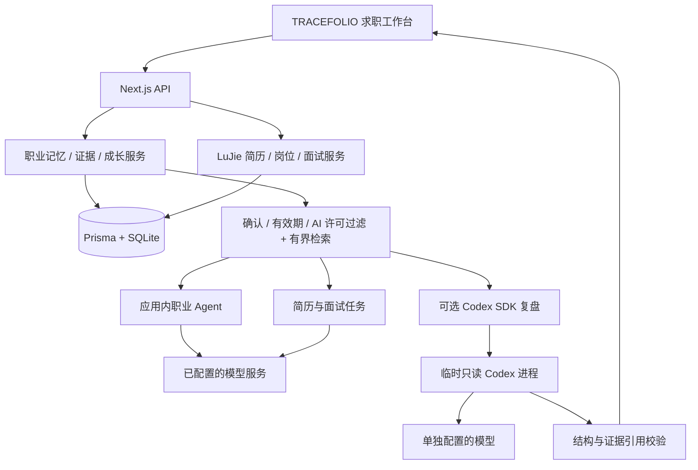

# 架构与数据设计

更新：2026-11-11。下图描述当前本机实现；商业部署目标在后文单独说明。

## 复用边界

应用层继承 LuJie 的 Next.js 16 / React 19、Prisma、SQLite、AI SDK、简历编辑与导出、岗位和投递记录、面试生成和应用内 Agent。`src/lib/career/` 是新增领域模块，`/intelligence` 是新增工作区。

Codex 接入目前集中在 `src/lib/career/codex.ts`：通过官方 TypeScript SDK 执行一个有明确输出结构的证据分析任务，不维护 Codex 源码分叉。既有 LuJie Agent 继续执行原有工具调用流程，没有被整体迁移到 Codex。这样可以独立测试新引擎，再决定哪些任务值得迁移。

官方资料将非交互任务、程序化 SDK 工作流和有持久会话 / 事件 / 审批需求的 app-server 区分开。当前单次复盘选择 SDK；商业版需要长任务、断线恢复和审批事件时再引入 app-server。参考 [Codex 平台说明](https://developers.openai.com/blog/codex-as-a-platform)、[SDK](https://developers.openai.com/codex/sdk/) 与 [app-server](https://developers.openai.com/codex/app-server/)。

## 新增实体

| 实体 | 关键字段 | 约束 |
| --- | --- | --- |
| CareerMemory | key、category、content、source、confirmed、useInAI、expiresAt、revision | key 唯一；读取使用确认 / 许可 / 有效期过滤；更新和删除比较 revision |
| CapabilityEvidence | title、sourceType、sourceRef、excerpt、contribution、skills、status、useInAI、revision | 材料类型保留；未确认或排除材料不用于分析；链接不自动读取 |
| GrowthAction | skill、title、evidenceTarget、status、completionEvidenceId | skill + title 去重；完成依据必须是已确认、标签匹配的作品或面试证据 |

新模块不自动把上游示例简历转换成用户画像；新表初始为空。已有 Resume、ResumeVersion、Job、Application、InterviewSession、InterviewPreparation、Settings、AgentThread 仍按上游模型保存。

## 检索与事实边界

本版先过滤确认、许可和有效期，再用问题与记录文本的词项重合进行排序，按完整记录装入最多 9,000 字符的数据预算，不在来源 ID 或摘录中间截断。未装入的证据不能被 Codex 输出引用。该机制适合小型本地档案，尚不等同于语义 RAG 或成熟的证据图谱。

`read_career_memory` 是只读 Agent 工具，能够在新对话中读取最新数据库状态。简历诊断 / 定制 / 优化、面试准备 / 报告和申请文案通过 `includeCareerContext` 显式启用相同过滤。连接测试和简历导入结构提取不读取职业记忆。背景用于目标与约束、措辞核对和提问，不自动向简历添加新任职或新项目。

v0.1 的证据覆盖按规范化后的标签精确关联，没有采用“JD 全文含某词就匹配”的方式；结果列出材料 ID 和下一步。别名表有限，复杂技能同义词、技能层级、经验年限与硬性门槛需要下一版扩充。整体岗位适合度继续依托上游 JD 工作流，新增模块只计算证据标签覆盖。

## Codex 执行边界

只在用户点击深度复盘且配置完整时运行。每次调用建立独立临时工作目录和运行时目录，SDK 子进程仅获得必要 PATH、专用运行时目录和本次模型凭证，不继承 GitHub PAT、开发者登录或全局 MCP 配置。

使用只读沙箱，禁用命令工具、图像读取、应用连接、网页搜索和工具安装，模型只处理输入材料。90 秒超时或请求取消会中断调用；成功和失败均清理临时目录。该封装不是对恶意代码执行的容器隔离证明；商业版引入仓库执行分析时必须有单独执行环境。

输出采用 JSON Schema 与 Zod 双重解析；每个 finding 必须引用实际送入上下文的 `evidence:ID`，且引用属于允许使用的已确认记录。纯自述不能被标为作品依据。引用有效只能证明结论指向了输入材料，不能证明自然语言结论本身完全正确，仍需质量评测与用户复核。

SDK 结果提供 token usage，目前只返回本次结果，没有持久化计费账本。并发锁仅限当前服务器进程；这不满足分布式 SaaS 的预算、队列和幂等要求。SDK 适配器自动化测试使用假运行时，不产生付费推理。

## 数据修正与删除

记忆主题唯一；修正及删除要求 revision 匹配，否则返回 409。修改或删除证据在事务内重新打开引用它的成长任务，清除完成依据。生成建议不自动写入记忆或证据。

删除只覆盖新领域库以及当前成长任务的关联失效；历史 Agent 对话、旧的简历版本、用户导出、备份和模型服务历史可能保留之前的信息。商业版需定义数据保留策略、派生结果依赖、全量导出、跨对象删除和可审计的删除任务，不能将单表删除宣传为完整遗忘。

## API

| 路径 | 方法 | 用途 |
| --- | --- | --- |
| `/api/career` | GET | 一致性快照与 Codex 配置可用状态，不返回密钥 |
| `/api/career/memories` | POST | 新增记忆 |
| `/api/career/memories/:id` | PATCH / DELETE | 带 revision 修正 / 删除 |
| `/api/career/evidence` | POST | 新增证据 |
| `/api/career/evidence/:id` | PATCH / DELETE | 带 revision 复核 / 删除并使成长关联失效 |
| `/api/career/match` | POST | 规则计算证据覆盖 |
| `/api/career/growth` | POST | 去重新增成长任务 |
| `/api/career/growth/:id` | PATCH | 关联完成证据或重新打开 |
| `/api/career/review` | POST | 可选 Codex 深度复盘 |

新写接口检查 Origin、JSON 格式和实际读取的 64 KiB 请求体上限。输入使用严格 schema；响应禁用缓存。当前缺少身份认证，不能作为公共 API 使用。

## 商业版演进

业务事实由应用数据库持有，运行时会话保存的是任务状态。未来切换 Codex app-server、其他模型或恢复一个任务时，都重新按用户身份构建上下文，不能把模型会话 ID 当作数据访问权限。

先为全部新旧实体加入 User / Workspace 所有权和可测试的租户访问层，再迁移 PostgreSQL；对象存储保存带 hash 与版本的材料，关系表保存 claim → evidence span → artifact revision 的关联。向量检索在需要时作为派生索引加入，不能取代原始事实库。

后台任务记录任务状态、输入快照、模型 / prompt 版本、成本预算、重试和取消。仓库分析在每次任务独立的容器 / 虚拟机中运行，限定网络、凭证、CPU、内存和时间。审批与计费在应用服务层判断，不能依赖 prompt 承诺。

面试采用每题状态机和明确的证据引用；语音、实时事件与断点恢复基于文字流程的稳定版本增加。支付权益、套餐额度和企业权限分别建模，不使用模型输出直接触发收费或对外投递。
