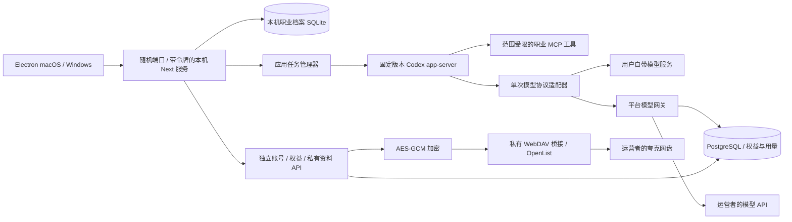

# 桌面端、模型连接与云服务

更新：2026-11-12。v0.2 是可打包的本地应用与独立云服务的开发版本，尚未完成生产商用验收。

## 运行边界



旧工作台与职业事实库仍属于本机单用户应用。独立云服务只运行 `services/cloud`，没有挂载原来的简历、记忆、对话、任务 API，不能将旧 Next 服务开放到公网冒充多租户服务。云端账号、会话、权益、资料、用量均以 `account_id` 隔离；客户端不能指定其他账号 ID。

Codex 保持原官方依赖，没有修改内核。Chat Completions 适配器每次只执行一次模型调用，工具执行和下一步循环继续由 Codex 决定。协议适配覆盖文字、函数调用、工具结果、结构化回答和用量；不支持图像、内置网页搜索、远程 MCP 等输入时明确失败。适配器暂存在内存中保留同一任务的供应商推理元数据，不跨任务复用。实际服务商的工具调用、推理签名和输出质量仍需逐家验证。

## 模型与账号

设置页新增“模型连接与平台账号”：保存多个连接，填写服务商、模型、服务地址、协议与密钥，再选择当前连接。选择本身不调用模型。选中的连接同时用于新 Codex 证据任务和既有 AI 工作流；未选择时兼容原设置和 Codex 环境配置。

新任务绑定模型、地址、协议、凭证摘要。排队期间连接改变会使任务失败，必须重新创建，防止材料被自动转送到另一服务。模型密钥加密存入本机 SQLite；桌面版的设备加密主密钥由 Electron `safeStorage` 通过系统安全存储保护。不读取用户全局 Codex 配置、ChatGPT 登录或开发者模型密钥。

平台连接使用登录会话访问云网关，运营者的模型密钥仅保留在云服务器环境中。普通聊天、结构化 AI 任务和 Codex 的模型调用都可通过同一平台网关，具体协议由平台目录决定。

### ChatGPT 订阅接入

当前商业版本没有启用 ChatGPT 登录，界面明确显示接入条件。OpenAI 当前文档说明，付费或远程托管应用需要先申请 **Sign in with ChatGPT** 接入资格；不能用原 app-server 自带认证绕过该要求。取得资格后，按官方 SDK、授权范围和应用注册要求实现独立认证适配。TRACEFOLIO 账号、ChatGPT 身份、订阅模型用量是三种不同的授权。

依据（核对于 2026-11-12）：

- [Sign in with ChatGPT](https://developers.openai.com/siwc)
- [官方桌面应用接入示例与付费应用限制](https://developers.openai.com/cookbook/articles/sign-in-with-chatgpt)
- [app-server 认证边界](https://learn.chatgpt.com/docs/app-server)

## 两类套餐

| 产品 | Agent 权益 | 平台模型 |
| --- | --- | --- |
| 仅 Agent 月费 | 按月延长 | 用户自带 API Key |
| 仅 Agent 年费 | 按年延长 | 用户自带 API Key |
| 仅 Agent 永久 | 永久使用权 | 用户自带 API Key |
| Agent ＋平台模型 | 配置对应时长 | 独立额度、模型白名单、额度有效期 |

模型额度与 Agent 使用权分开保存。永久 Agent 权益不会因后续购买月度模型套餐消失，也不代表无限期免费模型调用。旧的未过期模型额度不会被仅 Agent 续费抹除。价格与额度由运营者配置，默认不生成虚构售价或模型额度。

本版以管理员开通权益为可用入口，未接入微信 / 支付宝商户，也不会实际收款。开通编号幂等，可将未来已验签的支付订单 ID 作为 `grant_key`。尚未实现自动续费、退款、税务发票和支付争议处理。

云端每次模型请求验证会话、Agent 权益、模型白名单与额度有效期；事务内预留最大请求预算，再凭上游实际返回的用量结算。客户端 token 数字不作为账单依据。重复请求编号不重复推理；连接丢失、上游用量缺失或服务器中断保留预留，交由管理员核对，不能自动当作免费请求重试。用量单位是运营者定义的内部计量单位，不等同于人民币或供应商实际账单。

## 构建桌面安装包

在目标系统、对应架构上安装 Node.js 22+：

```bash
npm ci
npm run build
npm run desktop:prepare
node scripts/smoke-desktop.mjs
npx electron-builder --config desktop/electron-builder.yml --publish never
```

或者运行 `npm run desktop:pack` 完成构建、准备和打包。开发预览使用 `npm run desktop:dev`。输出位于 `outputs/desktop/`。macOS 目标为 DMG / ZIP，Windows 目标为 NSIS 安装 EXE。`.github/workflows/desktop.yml` 分别构建 macOS arm64、macOS x64、Windows x64，产物以 GitHub Actions artifact 保存，不自动公开发布。

构建付费分发版本前配置运营服务：

```bash
TRACEFOLIO_DESKTOP_CLOUD_URL=https://YOUR-CLOUD-DOMAIN
TRACEFOLIO_DESKTOP_REQUIRE_LICENSE=1
```

这些值在 `desktop:prepare` 时写入安装资源，商业版的 AI 功能会在线检查 Agent 权益，并固定账号服务地址。未配置时是开发版本。它不提供离线许可证或防修改 DRM。

安装资源含本地服务、Prisma 迁移、worker、对应平台的固定 Codex 运行时和开源许可；排除开发者 `.env`、数据库和个人材料。首次启动将 SQLite 和系统保护的设备密钥写入 Electron `userData`，不写入应用安装目录。窗口只允许当前本机来源，禁用 Node 集成、启用上下文隔离和沙箱；本地请求必须携带由主进程注入的随机会话令牌。普通浏览器或其他网页不能直接读写该随机端口。

Apple 签名 / 公证和 Windows 代码签名需要运营者证书；默认构建不声称已经签名。Windows 安装与系统行为仍需 Windows 实机验收。关闭应用会停止本机服务和 worker；已存职业资料保留。

## 启动独立云服务

```bash
npm ci --prefix services/cloud
cd services/cloud
cp .env.example .env
# 填写 PostgreSQL、随机存储主密钥、注册邀请码与桥接凭证
npm start
```

`TRACEFOLIO_STORAGE_KEY` 需要独立生成并安全备份，例如 `openssl rand -hex 32`。这是资料加密主密钥，不能丢失或随意替换。生产运行拒绝开发用本地文件存储。

也可以使用 `services/cloud/compose.yml`：在该目录的 `.env` 中额外配置随机 `TRACEFOLIO_POSTGRES_PASSWORD`，通过 `docker compose up -d --build` 启动 PostgreSQL 与云服务。端口默认只发布到服务器回环地址，在前方配置 HTTPS 反向代理。不要代理本机 Next.js 工作台到此公网域名。

配置 `TRACEFOLIO_MODELS_JSON` 定义模型别名、上游服务、服务端密钥、协议、输出限制与输入 / 输出计量费率；配置 `TRACEFOLIO_PRODUCTS_JSON` 定义两类套餐、时长、模型有效天数、额度、存储空间与显示价格，完整示例见 `services/cloud/.env.example`。

用户在桌面设置中注册后，运营者可开通套餐：

```bash
# 在 services/cloud 目录执行
npm run admin -- grant user@example.com agent-month RECEIPT-UNIQUE-ID
npm run admin -- grant user@example.com agent-year RECEIPT-UNIQUE-ID
npm run admin -- grant user@example.com agent-lifetime RECEIPT-UNIQUE-ID
npm run admin -- grant user@example.com bundle-month RECEIPT-UNIQUE-ID

# 查看请求状态，核对上游记录后处理不确定结果
npm run admin -- usage user@example.com
npm run admin -- resolve-usage user@example.com USAGE-UUID release
npm run admin -- resolve-usage user@example.com USAGE-UUID 1200 400

# 核对长时间没有完成回执的上传
npm run admin -- reconcile-uploads
```

每次开通必须使用不同的真实收据编号；重复同一编号不会二次发放。管理员命令只在持有数据库和服务端配置的环境中运行，没有向桌面暴露管理员接口。

## 夸克网盘

没有找到可核验、适合本产品直接集成的夸克通用上传 API 文档。`open.quark.cn` 当前展示小程序开发者平台，不能据此宣称获得网盘 API 权限。因此实现 **可替换的私有 WebDAV 存储接口**，通过运营者自己的 OpenList 等服务挂载夸克。没有内嵌夸克 Cookie、抓包登录或未经授权的网盘客户端接口。

部署桥接时，运营者按所用桥接的文档授权夸克驱动，建立专用资料目录与专用 WebDAV 用户，允许上传、建目录、读取和删除。设置下载为代理传输，禁止 302 跳转；本适配器拒绝跳转，避免将桥接凭证发送到其他主机。配置 HTTPS，或与云服务同一主机的回环 HTTP。

参考：[OpenList 夸克驱动文档源码](https://github.com/OpenListTeam/docs/blob/main/docs/guide/drivers/quark.md)、[WebDAV 文档源码](https://github.com/OpenListTeam/docs/blob/main/docs/guide/webdav.md)。该桥接不是夸克官方商业 API，上传 / 下载能力、稳定性与可用授权应以运营者实际挂载验收为准。当前尚未连接真实夸克账户。

用户逐次同意后上传选中的 PDF、Word、文字、JSON 或图片，单份上限 20 MiB。文件名等元数据保存在 PostgreSQL；内容由服务器加密，夸克端仅收到以账号 UUID / 资料 UUID / hash 命名的密文。下载和删除均经账号查询，不提供公开分享链接。下载同时核对加密认证、大小与 SHA-256。删除支持 revision 检查；未确认上传保留空间预留，管理员可核对恢复。

本机资料不因登录自动同步，云端资料也不自动写入职业记忆。删除当前对象不承诺清除网盘回收站、供应商日志或外部备份；这些生命周期操作尚需配置并验收。

## 验证与尚未接通的外部条件

自动化使用合成资料、内存 PostgreSQL 引擎 PGlite、假模型及假存储，测试账号隔离、会话过期、套餐权益、上传同意、资料修订、预留结算、幂等和 Codex 实际 CLI 与 MCP 传输。没有消耗真实付费模型额度。

`node scripts/smoke-platform.mjs` 额外贯通真实 Codex CLI → 本机模型适配 → HTTP 云网关 → 账号权益与用量预留 → 合成模型 → MCP 提案的整条链路，核对 5 次模型调用分别结算一次。`node scripts/smoke-desktop.mjs` 检查桌面本机服务的迁移、渲染、令牌、跨站拒绝和 worker 心跳。打包后运行 `node scripts/check-packaged-runtime.mjs`，使用安装资源内实际的 Electron 可执行文件与后端重跑检查；跨平台 CI 在上传安装包前执行同样验收。

服务器、域名、模型服务配置、夸克桥接授权、支付商户、签名证书与 OpenAI 商业订阅接入资格尚需运营者提供。账号服务目前采用邮箱密码、可选邀请码与 30 天会话，没有邮件验证、密码重置、MFA、设备管理或完整审计；限流是单实例内存实现。这一版本可用于集成验证，不能称为已上线的生产 SaaS。
